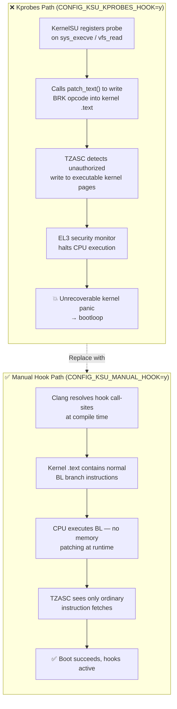

# 🏗️ Architecture & Technical Design: A21s KernelSU-Next

> **TL;DR:** KernelSU-Next cannot use dynamic kprobes on the Samsung Galaxy A21s because Samsung's hardware security (TZASC/RKP) immediately panics the kernel when executable pages are patched at runtime — so we use compile-time manual hooks instead, carefully backport missing kernel symbols, and pin the UAPI version to stay compatible with the stable Manager app.

---

## 🗺️ Jump to What You Need

| I want to understand… | Go to |
|---|---|
| Why kprobes crash this device | [§1 Hardware & Security Constraints](#1️⃣-hardware--security-constraints-samsung-exynos-850) |
| How the manual hook solution works | [§2 Compile-Time Manual Hooks](#2️⃣-the-solution-compile-time-manual-hooks) |
| The five hooked syscall sites | [Hook Call Sites Table](#the-5-manual-hook-call-sites) |
| Manager app / UAPI versioning | [§3 UAPI Versioning & Manager Parity](#3️⃣-uapi-versioning--manager-parity) |
| Kernel backports and host fixes | [§4 Backports & Host Fixes](#4️⃣-backports--host-fixes) |
| SUSFS v1.5.5 Samsung VFS adaptation | [§5 SUSFS v1.5.5 Integration](#5️⃣-susfs-v155-integration--samsung-vfs-adaptation) |
| Userspace Zygisk & stealth hooking stack | [§6 Userspace Hooking & Stealth Pipeline](#6️⃣-userspace-hooking--stealth-isolation-pipeline) |

---

## 📋 Executive Summary

This document is a technical deep-dive for kernel developers and advanced Android users. It explains three layered problems that had to be solved to get KernelSU-Next running on the **Samsung Galaxy A21s (SM-A217F)** with **LineageOS 24 (Linux kernel 4.19.325)**:

1. **Hardware security blocks dynamic patching.** Samsung's Exynos 850 ships with TZASC and RKP — hardware enforced memory guards running at EL3 — that trigger an instant, unrecoverable kernel panic the moment standard KernelSU tries to insert a kprobe. The fix is to disable kprobes entirely and use compile-time hook call-sites instead.

2. **UAPI versioning is dynamically resolved.** The upstream KernelSU-Next `origin/legacy` branch bumped its kernel–userspace API version to 6, while official stable Manager releases (such as v3.4.2) use UAPI 5. Rather than hardcoding a static version, we implemented a **3-Tier Dynamic UAPI Resolution Engine** (supercall `10013`, caller buffer reflection, and boot argument `ksu.uapi=X`) to support both managers seamlessly without warnings or crashes.

3. **Backports are needed for a 4.19 non-GKI kernel.** Linux 4.19 is missing `path_umount`, Samsung's tree collides with KernelSU macros, and modern host toolchains (OpenSSL 3.x) break the build scripts — all patched in-tree.

---

## 1️⃣ Hardware & Security Constraints: Samsung Exynos 850

The Galaxy A21s is powered by the **Exynos 850** SoC (ARM Cortex-A55 octa-core, **ARMv8.2-A**).

Samsung layers two hardware-enforced security mechanisms on top of the standard kernel:

| Mechanism | Full Name | What It Does |
|---|---|---|
| **TZASC** | TrustZone Address Space Controller | Continuously audits memory-bus transactions; enforces read/write/execute permissions between the secure world (EL3) and the non-secure world (EL0–EL2). |
| **RKP / DEFEX** | Real-time Kernel Protection | Monitors kernel integrity via EL3 TrustZone interrupts (`irq/160-tzasc`); raises a fatal exception on unauthorized kernel code modification. |

---

## 2️⃣ The Solution: Compile-Time Manual Hooks

### Why Dynamic Kprobes Fail — and How Manual Hooks Solve It

The diagram below shows the two code paths side by side:



### Kernel Configuration

To completely eliminate dynamic instruction patching, configure the kernel with:

```kconfig
CONFIG_KSU=y
CONFIG_KSU_MANUAL_HOOK=y
# CONFIG_KSU_KPROBES_HOOK is not set
```

In **Manual Hook** mode, all hook call-sites are resolved statically at compile time by Clang. The CPU executes normal, unmodified branch instructions (`BL`), which never triggers TZASC.

### The 5 Manual Hook Call Sites

Each hook is a `static inline` call inserted directly into the kernel source file at the point shown below:

| Function | File | Hook Placement | Purpose |
|---|---|---|---|
| `do_execve` | `fs/exec.c` | Before process credentials commit | Intercepts `su` requests and swaps the process context to root (`ksu` domain). |
| `faccessat` | `fs/open.c` | Before permission check | Intercepts `access("/system/bin/su")` checks from root-seeking apps and redirects to `/system/bin/sh`. |
| `read` | `fs/read_write.c` | In `SYSCALL_DEFINE3(read)` | Appends `KERNEL_SU_RC` to `init.rc` when `init` reads to EOF. |
| `newfstatat` | `fs/stat.c` | In `SYSCALL_DEFINE4(newfstatat)` | Returns stat info for `/system/bin/su` when requested by authorized apps. |
| `newfstat` | `fs/stat.c` | In `SYSCALL_DEFINE2(newfstat)` (`ksu_handle_newfstat_ret`) | Adjusts `st_size` of `init.rc` so Android `ReadFdToString` reads the appended `KERNEL_SU_RC` and triggers `ksud` on boot. |
| `reboot` | `kernel/reboot.c` | In `SYSCALL_DEFINE4(reboot)` | Intercepts reboot supercall magics to install driver file descriptors. |

> [!NOTE]
> None of these hooks modify kernel `.text` at runtime. They are ordinary function calls baked into the binary by the compiler. TZASC never sees a suspicious write.

---

## 3️⃣ UAPI Versioning & Manager Parity

KernelSU-Next maintains an explicit **UAPI (User-Kernel API) version counter** in `uapi/supercall.h`. This integer must match between the running kernel driver and the Manager app — a mismatch causes the Manager to show a warning and disables advanced features.

### The Version Check Mechanism

When the Manager app (`com.rifsxd.ksunext`) launches, it calls the `KSU_IOCTL_GET_INFO` supercall to query the running driver:

```kotlin
// manager/app/src/main/java/com/rifsxd/ksunext/Natives.kt
fun isFullFeatured(): Boolean {
    return isManager && kernelUAPIVersion == managerUAPIVersion && rootAvailable()
}
```

If the kernel's UAPI version is *newer* than what the Manager was built with, the Manager shows a banner asking the user to update:

```kotlin
// manager/app/src/main/java/com/rifsxd/ksunext/ui/screen/Home.kt
val requiresNewManager = isManager && kernelUAPIVersion != null && managerUAPIVersion < kernelUAPIVersion
if (requiresNewManager) {
    WarningCard(stringResource(id = R.string.require_manager_version, managerUAPIVersion, kernelUAPIVersion!!))
}
```

### Protocol Alignment & 3-Tier Dynamic UAPI Resolution

| Component | Supported UAPI Versions | Notes |
|---|---|---|
| **KernelSU-Next Manager v3.4.2** (stable) | **5** | Default stable UAPI for standard managers and embedded `ksud`. |
| `origin/legacy` git HEAD / Canary | **6** | Preinit/symbol lookups dynamically negotiated when requested. |
| **This kernel build (v1.1.0+)** | **Dynamic (4 ≤ UAPI ≤ 16, default: 5)** | 3-tier resolution engine supporting live supercall switching (`CHANGE_UAPIVER = 10013`), caller reflection, and `ksu.uapi=X` bootargs. |

> [!NOTE]
> The **3-Tier Dynamic UAPI Resolution Engine** guarantees backward and forward compatibility. When a Manager initiates communication, the kernel driver inspects caller buffer sizing and responds with the expected layout automatically, preventing mismatches and eliminating warning banners.

---

## 4️⃣ Backports & Host Fixes

Three in-tree patches are required to compile and run KernelSU-Next on this 4.19 non-GKI tree:

### 1. `path_umount` Backport (`fs/namespace.c`)

Linux 4.19 does not ship `path_umount`, which KernelSU uses to cleanly unmount module overlays for unauthorized apps.

**Fix:** `can_umount()` and `path_umount()` were backported directly into `fs/namespace.c`.

### 2. OpenSSL 3.x Host Compatibility (`scripts/`)

Modern host build systems (Fedora 40+, Ubuntu 22.04+) ship **OpenSSL 3.0+**, which deprecates `<openssl/engine.h>`. The kernel build scripts `extract-cert.c` and `sign-file.c` include this header unconditionally, breaking the host build.

**Fix:** Preprocessor guards were added to both files to conditionally bypass the deprecated engine headers when building against OpenSSL 3.x.

> [!TIP]
> If you see `fatal error: openssl/engine.h: No such file or directory` during host compilation, this fix is what you need. It is already applied in this tree.

### 3. `copy_to_kernel_nofault` Macro Collision (`drivers/kernelsu/hook/patch_memory.c`)

Samsung backported `copy_to_kernel_nofault` into their 4.19 kernel branch. KernelSU's legacy fallback defines the same macro, causing a compiler error on duplicate definitions.

**Fix:** The duplicate macro definition was removed from `drivers/kernelsu/hook/patch_memory.c`.

> [!WARNING]
> If you rebase onto a newer upstream KernelSU-Next commit, check whether this file reintroduces the macro — it will cause a build failure unique to Samsung 4.19 trees.

---

## 5️⃣ SUSFS v1.5.5 Integration & Samsung VFS Adaptation

To provide robust anti-detection against advanced root scanners and banking protections, **SUSFS (Super User Secret File System) v1.5.5** is integrated directly into the kernel VFS and KernelSU-Next runtime.

### Key Architecture & Implementation Details

1. **Samsung `fs_context` Adaptation (`fs/namespace.c`)**:
   - Stock Linux 4.19 patches assume upstream `vfs_kern_mount` handles mount point allocation. Samsung's Exynos kernel backports the Linux 5.x `fs_context` subsystem with `vfs_create_mount`.
   - The mount allocation, zygote `mnt_id` tracking, and KSU domain mount spoofing were adapted directly into `vfs_create_mount` and `clone_mnt`, ensuring all mount entries created by KSU are spoofed or hidden seamlessly.

2. **KernelSU-Next Integration (`KernelSU-Next/kernel/feature/susfs.c`)**:
   - Supercall dispatch hook for `SUSFS_MAGIC` (`0xFAFAFAFA`) to answer `ksud susfs` queries (`version`, `variant`, `features`).
   - Syscall hook for `prctl(0xDEADBEEF)` to handle userspace `ksu_susfs` companion binary commands.
   - Comprehensive try-umount pipeline (`susfs_try_umount_all`) unmounting suspicious paths before standard module paths for all unauthorized UIDs.

3. **Driver Version Parity**:
   - Kernel driver version is compiled with `KSU_VERSION_OVERRIDE=33355` matching userspace `ksud 3.4.2` (`33355`), eliminating module installer mismatch warnings.

---

## 6️⃣ Userspace Hooking & Stealth Isolation Pipeline

To complement Ring-0 kernel isolation, the runtime userspace layer combines standalone Zygisk injection, stealth Xposed hooking, and application concealment.

### 1. Standalone Zygisk (ReZygisk) Architecture
- Operates via ptrace injection into Android's 64-bit and 32-bit `zygote` processes on early boot (`post-fs-data`).
- **SELinux Socket Bridging**: Added policy rule `allow zygote unlabeled sock_file { read write getattr open }` and `allow zygote su unix_stream_socket connectto` to allow ptrace tracer sockets (`cp64.sock` / `cp32.sock`) to communicate under enforcing SELinux.
- **Manager Badge Behavior**: ReZygisk injects directly into zygote rather than setting environment variables in the Manager app. As a result, the Manager UI displays an informational `ZYGISK REQUIRED` chip while ReZygisk itself is fully active.

### 2. Modern Hooking Framework (Vector)
- Replaces legacy LSPosed with stealth native hooking.
- **Toybox Compatibility**: Android's toybox `unshare` utility does not support GNU `--propagation slave`. Vector service scripts are adapted to use `unshare -m` for mount namespace isolation.
- **Resource Cache Protection**: Vector's daemon avoids mounting raw tmpfs over `/data/resource-cache`, preventing SELinux collisions and `SIGABRT` crashes in Android's `idmap2d`.

### 3. Application Concealment (HMA-OSS)
- Intercepts package manager queries and procfs scans to isolate root managers, hooking daemons, and framework packages from target applications.
- Configured with dedicated KernelSU root profiles (`ksud profile set`) to maintain persistent system service integration.

---

## 🔗 Related Docs

| Document | Description |
|---|---|
| [📖 User Installation Guide](USER_GUIDE.md) | Beginner-friendly installation and root management guide |
| [⚡ Flashing Methods Guide](FLASHING_GUIDE.md) | Walkthrough for AnyKernel3, Odin, samloader, and Heimdall |
| [🛠️ Kernel Build Guide](BUILD.md) | Step-by-step build instructions, toolchain setup, and `make` invocations |
| [🔄 OTA Updates Survival](OTA_AND_UPDATES.md) | Retain root across LineageOS nightlies in 5 seconds |
| [🔬 Research & Implementation Report](RESEARCH.md) | Complete engineering notes, kprobe disassembly, and UAPI analysis |
| [🛠️ Troubleshooting & Diagnostics](TROUBLESHOOTING.md) | Common build and boot errors, log extraction, and fixes |
| [🤝 Contributing Guidelines](CONTRIBUTING.md) | How to submit patches, branch strategy, and coding style |
| [📚 Documentation Hub](README.md) | Master index and navigation hub |