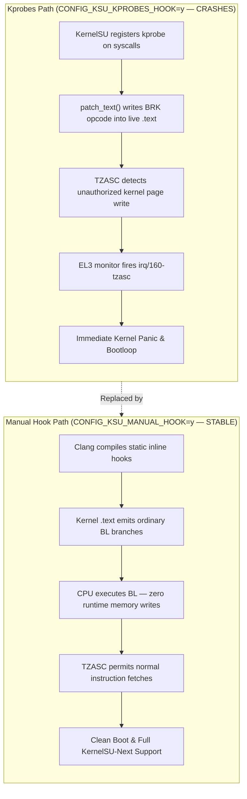

[← Documentation Hub](README.md) · [Main README](../README.md)

# Architecture & Technical Design — A21s KernelSU-Next

> **TL;DR:** Samsung's Exynos 850 TrustZone hardware (TZASC/RKP) panics immediately if `kprobes` patch live executable kernel text, so this kernel uses compile-time Manual Hooks, backports `path_umount`, dynamically negotiates UAPI `4–16` (`UAPI 5` default), embeds Keymaster DAK SELinux rules, and integrates SUSFS `v1.5.5` into Samsung's `fs_context` VFS.

---

## Jump to What You Need

| I want to understand… | Go to… |
| :--- | :--- |
| Why kprobes crash the Exynos 850 (`irq/160-tzasc`) | [Hardware & Security Constraints (Exynos 850)](#hardware--security-constraints-samsung-exynos-850) |
| How compile-time manual hooks avoid TZASC traps | [The Solution: Compile-Time Manual Hooks](#the-solution-compile-time-manual-hooks) |
| Every patched kernel hook call-site | [Manual Hook Call Sites (5 Syscall Paths / 6 Functions)](#manual-hook-call-sites-5-syscall-paths--6-functions) |
| Manager APK UAPI 5 parity & 3-tier dynamic engine | [UAPI Versioning & Manager Parity](#uapi-versioning--manager-parity) |
| `path_umount`, OpenSSL 3.x & `copy_to_kernel_nofault` fixes | [Backports, Host Fixes & Built-in DAK SELinux](#backports-host-fixes--built-in-dak-selinux) |
| SUSFS `v1.5.5` Samsung `fs_context` & `prctl` guard | [SUSFS v1.5.5 Integration & Samsung VFS Adaptation](#susfs-v155-integration--samsung-vfs-adaptation) |
| Userspace `ReZygisk`, `Vector`, `HMA-OSS` & `AlwaysStrong` pipeline | [Userspace Hooking & Stealth Isolation Pipeline](#userspace-hooking--stealth-isolation-pipeline) |

---

## Executive Summary

Getting [KernelSU-Next](https://github.com/KernelSU-Next/KernelSU-Next/tree/legacy) + [SUSFS v1.5.5](https://gitlab.com/simonpunk/susfs4ksu/-/tree/kernel-4.19) running cleanly on the **Samsung Galaxy A21s (`SM-A217F` / LineageOS 24 / Linux `4.19.325`)** requires four coordinated layers:

1. **Eliminating runtime code patching:** Exynos 850 EL3 TrustZone (`TZASC` / `RKP`) traps kprobe `BRK` writes (`irq/160-tzasc`). Switching strictly to `CONFIG_KSU_MANUAL_HOOK=y` places static Clang `BL` branches in [`0002-kernelsu-manual-hooks-and-backports.patch`](../patches/0002-kernelsu-manual-hooks-and-backports.patch).
2. **Protocol & driver parity:** `KSU_VERSION_OVERRIDE=33355` plus a 3-tier Dynamic UAPI Engine (`4 <= UAPI <= 16`, default `5`) in [`0003-kernelsu-next-samsung-fixes.patch`](../patches/0003-kernelsu-next-samsung-fixes.patch) keep stable [KernelSU-Next Manager v3.4.2](https://github.com/KernelSU-Next/KernelSU-Next/releases/tag/v3.4.2) and newer clients happy without recompiles.
3. **4.19 backports & built-in Keymaster SELinux:** Backports `path_umount` (`fs/namespace.c`), fixes OpenSSL 3.x host tools ([`0001`](../patches/0001-build-host-openssl-3-compat.patch)), strips duplicate `copy_to_kernel_nofault`, and embeds `hal_keymaster_default` DAK permissions directly in `rules.c`.
4. **SUSFS v1.5.5 on Samsung `fs_context`:** [`0004-susfs-v1.5.5-kernel-4.19.patch`](../patches/0004-susfs-v1.5.5-kernel-4.19.patch) adapts upstream Linux 4.19 mount hooks to Samsung's `vfs_create_mount`/`clone_mnt` and restricts `prctl(0xDEADBEEF)` to `GLOBAL_ROOT_UID`.

---

## Hardware & Security Constraints: Samsung Exynos 850

| Mechanism | Full Name | Hardware Role |
| :--- | :--- | :--- |
| **TZASC** | TrustZone Address Space Controller | Audits DRAM bus transactions and enforces strict Non-Secure (`EL0`–`EL2`) vs Secure (`EL3`) memory permissions. |
| **RKP / DEFEX** | Real-time Kernel Protection | Monitors kernel `.text` integrity via EL3 interrupts (`irq/160-tzasc`); triggers an unrecoverable panic on live code modification. |

---

## The Solution: Compile-Time Manual Hooks



Configured in [`configs/a21s_ksu_defconfig`](../configs/a21s_ksu_defconfig):

```kconfig
CONFIG_KSU=y
CONFIG_KSU_MANUAL_HOOK=y
# CONFIG_KSU_KPROBES_HOOK is not set
```

### Manual Hook Call Sites (5 Syscall Paths / 6 Functions)

Patched in [`0002-kernelsu-manual-hooks-and-backports.patch`](../patches/0002-kernelsu-manual-hooks-and-backports.patch):

| Syscall / Entry | Kernel File | Hook Function | Purpose |
| :--- | :--- | :--- | :--- |
| `do_execve` / `compat` | `fs/exec.c` | `ksu_handle_execveat` | Intercepts `su` execution and transitions authorized UIDs to root. |
| `faccessat` | `fs/open.c` | `ksu_handle_faccessat` | Controls visibility of `/system/bin/su` (`-ENOENT` for ungranted apps). |
| `read` | `fs/read_write.c` | `ksu_handle_sys_read` | Injects `KERNEL_SU_RC` at EOF when `init` reads `init.rc`. |
| `newfstatat` | `fs/stat.c` | `ksu_handle_stat` | Spoofs stat metadata for `/system/bin/su` when authorized. |
| `newfstat` | `fs/stat.c` | `ksu_handle_newfstat_ret` | Adjusts `init.rc` `st_size` so Android 14–17 `init` (`ReadFdToString`) loads `KERNEL_SU_RC` and runs `ksud post-fs-data` / `services` / `boot-completed`. |
| `reboot` | `kernel/reboot.c` | `ksu_handle_sys_reboot` | Handles `ksud` supercall magics (`0xDEADBEEF` / `0xCAFEBABE`). |

---

## UAPI Versioning & Manager Parity

| Component | UAPI / Driver | Behavior |
| :--- | :--- | :--- |
| **[KernelSU-Next Manager v3.4.2](https://github.com/KernelSU-Next/KernelSU-Next/releases/tag/v3.4.2)** | `UAPI 5` / Driver `33355` | Stable release UI and embedded `ksud`. |
| **Upstream `legacy` HEAD / Canary** | `UAPI 6` | Adds newer preinit/symbol supercall structs. |
| **This Kernel ([`0003` patch](../patches/0003-kernelsu-next-samsung-fixes.patch))** | **Dynamic (`4–16`, default `5`) / Driver `33355`** | Supports stable v3.4.2 natively while auto-reflecting newer caller structs. |

**3-Tier Resolution Order:**
1. **Caller auto-reflection (`dispatch.c`):** If caller sets `4 <= in_cmd.uapi_version <= 16`, mirror it cleanly.
2. **Runtime override (`CHANGE_UAPIVER = 10013`):** Root supercall updates `ksu_uapi_override` without rebooting.
3. **Bootarg override (`ksu.uapi=X`):** `module_param_named(uapi, ksu_uapi_override, uint, 0)` sets the reported UAPI at boot.

---

## Backports, Host Fixes & Built-in DAK SELinux

1. **`path_umount` (`fs/namespace.c`):** Backported `can_umount()` and `path_umount()` from Linux 5.9+ ([`0002`](../patches/0002-kernelsu-manual-hooks-and-backports.patch)) for namespace module unmounting.
2. **OpenSSL 3.x Host Build (`scripts/`):** Guarded deprecated `<openssl/engine.h>` in `extract-cert.c` and `sign-file.c` ([`0001`](../patches/0001-build-host-openssl-3-compat.patch)) for modern Linux toolchains.
3. **`copy_to_kernel_nofault` Collision (`KernelSU-Next/kernel/`):** Stripped KernelSU's fallback macro duplicate since Samsung backported it into `4.19.325` ([`0003`](../patches/0003-kernelsu-next-samsung-fixes.patch)).
4. **Built-in Keymaster DAK SELinux (`KernelSU-Next/kernel/selinux/rules.c`):** Embedded `hal_keymaster_default` access to `prov_efs_file` and `efs_file` (`/mnt/vendor/efs/DAK/`) plus `KSU_MANAGER_PACKAGE := com.rifsxd.ksunext` ([`0003`](../patches/0003-kernelsu-next-samsung-fixes.patch)), eliminating `ret -932` attestation failures out of the box.

---

## SUSFS v1.5.5 Integration & Samsung VFS Adaptation

Implemented cleanly on top of `0001`–`0003` in [`0004-susfs-v1.5.5-kernel-4.19.patch`](../patches/0004-susfs-v1.5.5-kernel-4.19.patch):

- **Samsung `fs_context` Adaptation (`fs/namespace.c`):** Adapted Linux 4.19 SUSFS mount tracking (`vfs_kern_mount`) to Samsung's backported `vfs_create_mount` and `clone_mnt`, hiding KSU/overlay mounts per UID.
- **Root-Guarded `prctl(0xDEADBEEF)` (`kernel/sys.c`):** Added `uid_eq(current_uid(), GLOBAL_ROOT_UID)` around SUSFS `prctl` handling so non-root probes (e.g., Duck Detector `Native Root`) receive `-EINVAL` instead of confirming KernelSU/SUSFS presence.
- **Supercall Dispatch (`KernelSU-Next`):** Exposes `SUSFS_MAGIC` (`0xFAFAFAFA`) so KernelSU-Next Manager reports `SuSFS version: Supported | v1.5.5 (NON-GKI)`.

---

## Userspace Hooking & Stealth Isolation Pipeline

- **[ReZygisk](https://github.com/PerformanC/ReZygisk):** Ptrace tracer Zygote injection with SELinux `allow zygote unlabeled sock_file` socket rules so `cp64.sock`/`cp32.sock` stay enforcing.
- **[Vector](https://github.com/JingMatrix/Vector):** Stealth Xposed framework compatible with Android toybox (`unshare -m` without GNU-only `--propagation slave`, avoiding `idmap2d` tmpfs SELinux aborts).
- **[HMA-OSS](https://github.com/frknkrc44/HMA-OSS):** Conceals root/framework packages from target apps.
- **[AlwaysStrong](https://gitlab.com/Evokerr/AlwaysStrong/-/releases):** All-in-one Play Integrity (`TEESimulator` + `autopif4` + keybox) achieving `MEETS_BASIC`, `MEETS_DEVICE`, and `MEETS_STRONG_INTEGRITY` cleanly alongside the built-in DAK SELinux fix.

---

## Related Docs

| Document | Description |
| :--- | :--- |
| [Technical Research Report](RESEARCH.md) | Raw `pstore` crash evidence, partition geometry, and overlay design |
| [Kernel Build Guide](BUILD.md) | Compilation methods, CI workflow, and `susfs4ksu-v1.5.5.zip` packaging |
| [User Installation Guide](USER_GUIDE.md) | End-user setup, module stack, and Duck Detector audit guide |
| [Troubleshooting & Diagnostics](TROUBLESHOOTING.md) | Automated bug reporter, Blindspots 1–5, and recovery tips |
| [Contributing Guidelines](CONTRIBUTING.md) | Submitting clean patches and porting to other Exynos 4.19 targets |
| [Documentation Hub](README.md) | Master index of docs and upstream sources |
