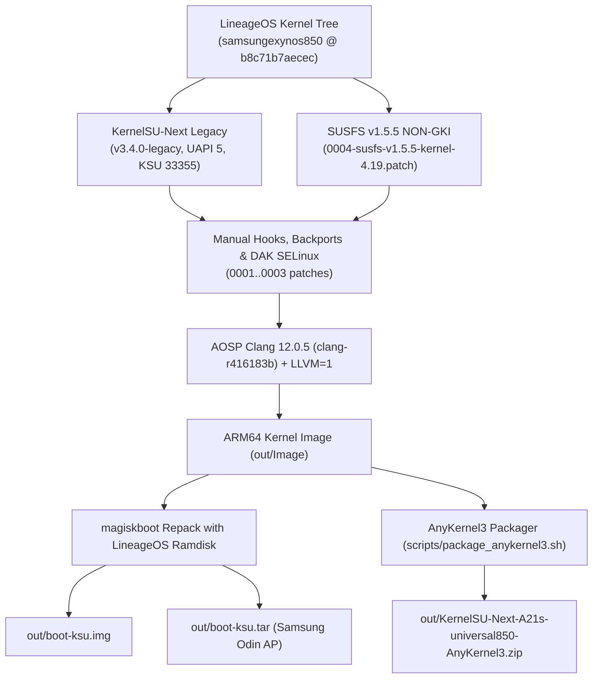

[← Documentation Hub](README.md) · [Main README](../README.md)

# Kernel Compilation & Build Guide — Galaxy A21s KernelSU-Next

> Step-by-step instructions for building the **Samsung Galaxy A21s (`SM-A217F` / Exynos 850)** Linux `4.19.325` kernel with **KernelSU-Next** and **SUSFS v1.5.5**, packaging `boot-ksu.img` / `boot-ksu.tar` / `AnyKernel3.zip`, and building the version-matched **`susfs4ksu-v1.5.5.zip`** companion module.

---

## Jump to What You Need

| Method / Topic | Environment | Setup Time | Best For |
| :--- | :--- | :---: | :--- |
| [Method A: GitHub Actions (Cloud Build)](#method-a-github-actions-cloud-build-zero-local-setup) | Any Web Browser | 0 min | Zero setup, cloud CI artifacts |
| [Method B: Universal Python CLI (`build.py`)](#method-b-universal-python-cli-cross-platform) | Windows / macOS / Linux | ~2 min | Cross-platform checks, packaging & Docker wrapper |
| [Method C: Docker & Docker Compose](#method-c-docker--compose-reproducible-builds) | Any Docker host | ~5 min | Reproducible containerized compilation |
| [Method D: Native Linux / WSL2](#method-d-native-linux--wsl2-compilation) | Ubuntu 22.04+ / Fedora / Arch | ~15 min | Kernel development & patch editing |
| [Building `susfs4ksu-v1.5.5.zip`](#building-the-susfs-v155-companion-module-susfs4ksu-v155zip) | Git + Zip *(or Android NDK)* | ~1 min | Rebuilding the version-matched SUSFS module |
| [Verification & Build Testing](#verification--build-testing) | Linux / WSL2 / macOS | ~1 min | Integrity checking every output file before flashing |

---

## Build Architecture Flow



---

## Prerequisites & Toolchains

| Component | Version / Pin | Reference |
| :--- | :--- | :--- |
| **Base Kernel** | Linux `4.19.325` (`b8c71b7aecec`) | [`samsungexynos850/android_kernel_samsung_exynos850`](https://github.com/samsungexynos850/android_kernel_samsung_exynos850/tree/lineage-24.0) (`lineage-24.0`) |
| **Root Driver** | KernelSU-Next `legacy` (`33355` / UAPI `5`) | [`KernelSU-Next/KernelSU-Next`](https://github.com/KernelSU-Next/KernelSU-Next/tree/legacy) |
| **SUSFS Extension** | SUSFS `v1.5.5` (`NON-GKI`) | [`simonpunk/susfs4ksu`](https://gitlab.com/simonpunk/susfs4ksu/-/tree/kernel-4.19) (`kernel-4.19`) |
| **Compiler** | Google AOSP Clang `12.0.5` (`clang-r416183b`) | [`android_prebuilts_clang_kernel_linux-x86_clang-r416183b`](https://github.com/LineageOS/android_prebuilts_clang_kernel_linux-x86_clang-r416183b) |
| **Repacker** | `magiskboot` (`x86_64`) | [`magiskboot-x86_64/magiskboot`](https://github.com/magiskboot-x86_64/magiskboot) |
| **Kernel Config** | Exynos 850 KSU + SUSFS defconfig | [`configs/a21s_ksu_defconfig`](../configs/a21s_ksu_defconfig) |
| **Patch Stack** | Sequential clean patches (`0001`–`0004`) | [`patches/`](../patches/) |

---

## Method A: GitHub Actions (Cloud Build, Zero Local Setup)

Run the entire compilation pipeline on GitHub's cloud runners without downloading gigabytes of kernel source or Clang locally:

1. Open [GitHub Actions → Build Kernel](https://github.com/rebeeh/A21s-KernelSU-Next/actions/workflows/build-kernel.yml) (defined in [`.github/workflows/build-kernel.yml`](../.github/workflows/build-kernel.yml)).
2. Click **Run workflow** on `main`.
3. The workflow automatically:
   - Clones `clang-r416183b`, `android_kernel_samsung_exynos850` (`lineage-24.0`), and `KernelSU-Next` (`legacy`) on `ubuntu-24.04`.
   - Applies [`0001`](../patches/0001-build-host-openssl-3-compat.patch) through [`0004`](../patches/0004-susfs-v1.5.5-kernel-4.19.patch).
   - Builds `Image` using [`configs/a21s_ksu_defconfig`](../configs/a21s_ksu_defconfig) and packages `boot-ksu.img`, `boot-ksu.tar`, and `KernelSU-Next-A21s-universal850-AnyKernel3.zip`.
4. Download the artifacts from the workflow summary (or check [GitHub Releases (`latest`)](https://github.com/rebeeh/A21s-KernelSU-Next/releases/latest)).

---

## Method B: Universal Python CLI (Cross-Platform)

[`build.py`](../build.py) provides cross-platform tooling on Windows, macOS, and Linux using only Python 3:

```bash
# 1. Inspect host toolchain dependencies, ADB, and Docker readiness
python3 build.py doctor

# 2. Package the AnyKernel3 flashable recovery zip (uses out/Image + tools/anykernel3/)
python3 build.py package

# 3. Wrap out/boot-ksu.img into a Samsung Odin AP archive (out/boot-ksu.tar)
python3 build.py make-tar

# 4. Launch a reproducible containerized kernel build via Docker
python3 build.py docker-build

# 5. Collect Android / Recovery logs (ramoops, dmesg, logcat, ksud) for bug reports
python3 build.py report-issue
```

---

## Method C: Docker & Compose (Reproducible Builds)

Using [`Dockerfile`](../Dockerfile) and [`docker-compose.yml`](../docker-compose.yml) eliminates host OS library and OpenSSL discrepancies:

1. Place your baseline LineageOS 24 `boot.img` in the repository root.
2. Build and compile:
   ```bash
   docker compose up --build
   ```
3. Check the generated files in `out/`:
   - `out/Image`
   - `out/boot-ksu.img`
   - `out/boot-ksu.tar`
   - `out/KernelSU-Next-A21s-universal850-AnyKernel3.zip`

---

## Method D: Native Linux / WSL2 Compilation

Recommended for active kernel developers editing [`patches/`](../patches/) or [`configs/a21s_ksu_defconfig`](../configs/a21s_ksu_defconfig).

### Step 1: Install Host Dependencies

```bash
sudo apt-get update && sudo apt-get install -y \
    build-essential libssl-dev libncurses5-dev bc bison flex \
    git curl wget tar xz-utils python3 jq cpio zip lz4
```

### Step 2: Run Environment Setup

[`scripts/setup_env.sh`](../scripts/setup_env.sh) prepares `build/` (clones `clang-r416183b`, downloads `magiskboot`, clones `android_kernel_samsung_exynos850` and `KernelSU-Next`, links `drivers/kernelsu`, and applies [`0001`](../patches/0001-build-host-openssl-3-compat.patch)–[`0004`](../patches/0004-susfs-v1.5.5-kernel-4.19.patch)):

```bash
chmod +x scripts/*.sh
./scripts/setup_env.sh
```

### Step 3: Compile and Repack

Run [`scripts/build.sh`](../scripts/build.sh) passing your baseline LineageOS `boot.img`:

```bash
./scripts/build.sh boot.img
```

[`scripts/build.sh`](../scripts/build.sh) performs the following steps:
1. Exports `ARCH=arm64`, `SUBARCH=arm64`, `CROSS_COMPILE=aarch64-linux-gnu-`, and Clang 12 flags (`CC=clang`, `LLVM=1`).
2. Syncs [`configs/a21s_ksu_defconfig`](../configs/a21s_ksu_defconfig) (`CONFIG_KSU=y`, `CONFIG_KSU_MANUAL_HOOK=y`, `CONFIG_KSU_SUSFS=y`).
3. Builds `arch/arm64/boot/Image` and copies it to `out/Image`.
4. Splits your baseline `boot.img` with `magiskboot` and repacks `out/boot-ksu.img` + `out/boot-ksu.tar`.

### Step 4: Package `AnyKernel3` Zip

Run [`scripts/package_anykernel3.sh`](../scripts/package_anykernel3.sh) to build the recovery installer zip using [`tools/anykernel3/anykernel.sh`](../tools/anykernel3/anykernel.sh):

```bash
./scripts/package_anykernel3.sh
```

---

## Building the SUSFS v1.5.5 Companion Module (`susfs4ksu-v1.5.5.zip`)

The SUSFS kernel driver (`CONFIG_KSU_SUSFS=y`) communicates with userspace via `prctl(0xDEADBEEF)`. Because `susfs4ksu` is version-coupled between the kernel patch (`v1.5.5`) and the userspace binary (`ksu_susfs_arm64`), you can either download [`susfs4ksu-v1.5.5.zip`](https://github.com/rebeeh/A21s-KernelSU-Next/releases/latest/download/susfs4ksu-v1.5.5.zip) from Releases or package it yourself from upstream [`simonpunk/susfs4ksu`](https://gitlab.com/simonpunk/susfs4ksu/-/tree/kernel-4.19) (`kernel-4.19` branch):

### Option 1: Package Upstream Template + Prebuilt Static Binary (Recommended)

Upstream `simonpunk/susfs4ksu` (`kernel-4.19`) tracks the statically linked `ksu_susfs_arm64` binary (`arm64-v8a`) directly inside `ksu_module_susfs/tools/`. Packaging from it requires only `git` and `zip`:

```bash
REPO_ROOT="$(pwd)"
git clone --depth=1 -b kernel-4.19 https://gitlab.com/simonpunk/susfs4ksu.git /tmp/susfs4ksu-4.19
(cd /tmp/susfs4ksu-4.19/ksu_module_susfs && zip -r9 "$REPO_ROOT/out/susfs4ksu-v1.5.5.zip" .)
```

> [!TIP]
> Upstream's `build_ksu_module.sh` runs `zip -r9 ../ksu_module_susfs.zip *`. Using `.` instead of `*` preserves the root dotfiles (`.susfs_*` template markers), matching our release asset `susfs4ksu-v1.5.5.zip`.

### Option 2: Recompile `ksu_susfs_arm64` from C Source (`ndk-build`)

If you modify `ksu_susfs/jni/main.c` or want to compile the userspace binary yourself instead of using `simonpunk`'s tracked binary, install the **Android NDK** (`r27+` / `r28`) and add it to `PATH`:

```bash
REPO_ROOT="$(pwd)"
git clone --depth=1 -b kernel-4.19 https://gitlab.com/simonpunk/susfs4ksu.git /tmp/susfs4ksu-4.19
cd /tmp/susfs4ksu-4.19
./build_ksu_susfs_tool.sh   # runs ndk-build in ksu_susfs/ (LOCAL_LDFLAGS := -static, APP_ABI := arm64-v8a)
(cd ksu_module_susfs && zip -r9 "$REPO_ROOT/out/susfs4ksu-v1.5.5.zip" .)
```

> [!NOTE]
> Alternatively, some users replace the minimal `ksu_module_susfs` script module with a WebUI community fork such as [`sidex15/susfs4ksu-module`](https://github.com/sidex15/susfs4ksu-module), provided its bundled `ksu_susfs` binary matches kernel SUSFS **v1.5.5**.

---

## Verification & Build Testing

Before flashing any output artifact, verify image format, archive integrity, and partition size limit (`<= 37,748,736` bytes / `36 MiB`):

```bash
# 1. Check kernel image format and architecture
file out/Image
# Expected: Linux kernel ARM64 boot executable Image, little-endian

# 2. Check boot-ksu.img fits within the 36 MiB SM-A217F partition limit
stat -c '%n: %s bytes' out/boot-ksu.img

# 3. Check AnyKernel3 & SUSFS companion zip integrity
unzip -t out/KernelSU-Next-A21s-universal850-AnyKernel3.zip
unzip -t out/susfs4ksu-v1.5.5.zip

# 4. Check Odin tar structure
tar -tvf out/boot-ksu.tar
# Expected: boot.img inside archive
```

---

## Related Docs

| Document | Description |
| :--- | :--- |
| [User Installation Guide](USER_GUIDE.md) | Flash prebuilt releases and configure the stealth module stack |
| [Flashing Methods Guide](FLASHING_GUIDE.md) | Detailed walkthrough for AnyKernel3, `samloader`, Odin, and Heimdall |
| [OTA Updates Survival](OTA_AND_UPDATES.md) | Keep root across LineageOS updates without recompiling |
| [Technical Architecture](ARCHITECTURE.md) | Deep dive on Exynos 850 TZASC, Manual Hooks, UAPI 5, and SUSFS |
| [Troubleshooting & Diagnostics](TROUBLESHOOTING.md) | Diagnose bootloops, pull `ramoops`/`dmesg`, and resolve issues |
| [Contributing Guidelines](CONTRIBUTING.md) | Export clean patches, test changes, and submit pull requests |
| [Documentation Hub](README.md) | Master index of all guides and upstream links |
