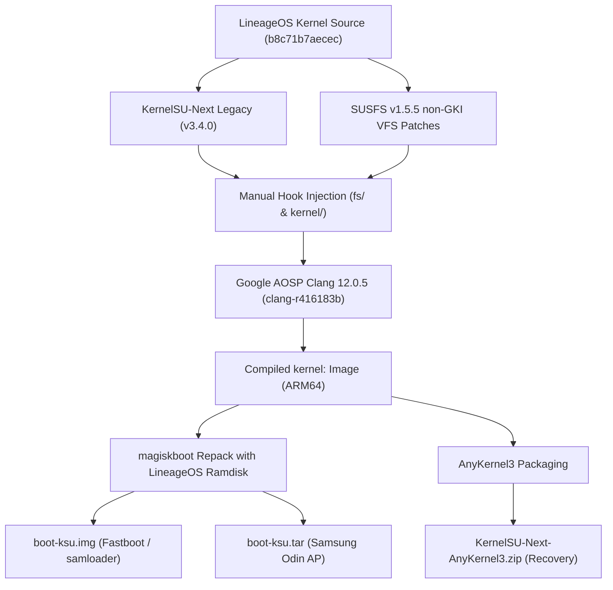

# 🛠️ Kernel Compilation & Build Guide — Galaxy A21s KernelSU-Next

> A comprehensive, step-by-step guide to compiling the **Samsung Galaxy A21s (SM-A217F / Exynos 850)** Linux 4.19 kernel with **KernelSU-Next** and **SUSFS v1.5.5** from source, repacking boot images, and creating flashable distribution archives.

---

## 🗺️ Jump to What You Need

| Method | Environment | Setup Time | Best For |
|---|---|:---:|---|
| [Method A — GitHub Actions (Cloud Build)](#️-method-a--github-actions-cloud-build-zero-local-setup) | Any Web Browser | 0 min | Zero setup, prebuilt releases |
| [Method B — Universal Python CLI](#-method-b--universal-python-cli-cross-platform) | Windows / macOS / Linux | 2 min | Automated local builds & packaging |
| [Method C — Docker & Docker Compose](#-method-c--docker--compose-reproducible-builds) | Any Docker host | 5 min | Byte-for-byte reproducible builds |
| [Method D — Native Linux / WSL2](#-method-d--native-linux--wsl2-compilation) | Ubuntu 22.04+ / Arch / Fedora | 15 min | Kernel hackers & active development |

---

## 📋 Build Architecture Flow



---

## ⚙️ Prerequisites & Toolchains

Before compiling locally, ensure you have the required components:

| Component | Target / Version | Description |
|---|---|---|
| **Base Kernel** | Linux `4.19.325` | LineageOS universal850 tree (`lineage-24.0` / commit `b8c71b7aecec`) |
| **Toolchain** | Google AOSP Clang `12.0.5` | `clang-r416183b` with integrated LLVM tools (`LLVM=1`) |
| **Cross Tools** | GCC 9+ / AArch64 | `aarch64-linux-gnu-` and `arm-linux-gnueabi-` (for compat vdso) |
| **Repacker** | `magiskboot` (v27.0+) | Splits stock `boot.img` and repacks kernel with LineageOS ramdisk |
| **Distribution** | `AnyKernel3` | Universal recovery installer for ramdisk preservation |

---

## ☁️ Method A — GitHub Actions (Cloud Build, Zero Local Setup)

The easiest way to compile without installing multi-gigabyte toolchains locally:

1. Navigate to the repository's [GitHub Actions Build Workflow](https://github.com/rebeeh/A21s-KernelSU-Next/actions/workflows/build-kernel.yml).
2. Click **Run workflow** on the `main` branch.
3. The workflow will:
   - Provision an **Ubuntu 24.04** runner.
   - Fetch the exact LineageOS 24 kernel tree and AOSP Clang toolchain.
   - Inject the KernelSU-Next manual hooks, SUSFS v1.5.5 patches, and Samsung VFS adaptations.
   - Compile the kernel and generate `boot-ksu.img`, `boot-ksu.tar`, and `KernelSU-Next-A21s-universal850-AnyKernel3.zip`.
4. Download the generated artifacts directly from the workflow summary or the [Releases page](https://github.com/rebeeh/A21s-KernelSU-Next/releases/latest).

---

## 🐍 Method B — Universal Python CLI (Cross-Platform)

The project includes an autonomous build orchestrator [`build.py`](../build.py) that works seamlessly on Windows, macOS, and Linux:

```bash
# 1. Inspect host toolchain dependencies and environment status
python3 build.py doctor

# 2. Package the AnyKernel3 flashable recovery zip
python3 build.py package

# 3. Generate the Samsung Odin-compatible boot-ksu.tar package
python3 build.py make-tar

# 4. Trigger a hermetic build inside a standardised Docker container
python3 build.py docker-build

# 5. Automatically diagnose connected device and capture crash logs
python3 build.py report-issue
```

---

## 🐳 Method C — Docker & Compose (Reproducible Builds)

Docker eliminates host compiler discrepancies and OpenSSL header version conflicts:

1. Place your target LineageOS stock `boot.img` in the repository root directory.
2. Build the container and compile:
   ```bash
   docker compose up --build
   ```
3. Artifacts are automatically deposited in the `out/` folder:
   - `out/Image`
   - `out/boot-ksu.img`
   - `out/boot-ksu.tar`
   - `out/KernelSU-Next-A21s-universal850-AnyKernel3.zip`

---

## 🐧 Method D — Native Linux / WSL2 Compilation

For active developers hacking on kernel drivers and manual hooks:

### Step 1: Install Host Dependencies

```bash
sudo apt-get update && sudo apt-get install -y \
    build-essential libssl-dev libncurses5-dev bc bison flex \
    git curl wget tar xz-utils python3 jq cpio zip lz4
```

### Step 2: Run Environment Setup

The [`scripts/setup_env.sh`](../scripts/setup_env.sh) script automatically clones the AOSP Clang toolchain, fetches `magiskboot`, and applies host OpenSSL patches:

```bash
chmod +x scripts/*.sh
./scripts/setup_env.sh
```

### Step 3: Compile and Repack

Run [`scripts/build.sh`](../scripts/build.sh) pointing to your baseline `boot.img`:

```bash
./scripts/build.sh boot.img
```

The build script will:
1. Export architecture variables (`ARCH=arm64`, `SUBARCH=arm64`, `CROSS_COMPILE=aarch64-linux-gnu-`).
2. Point compiler flags to Clang 12 (`CC=clang`, `LLVM=1`).
3. Load [`configs/a21s_ksu_defconfig`](../configs/a21s_ksu_defconfig).
4. Build `Image` with manual hook mode (`CONFIG_KSU_MANUAL_HOOK=y`).
5. Repack with `magiskboot` and output `out/boot-ksu.img` and `out/boot-ksu.tar`.

### Step 4: Package AnyKernel3 Zip

To package a recovery-flashable zip for distribution:

```bash
./scripts/package_anykernel3.sh
```

---

## 🎯 Verification & Build Testing

After compilation, verify the produced artifacts before flashing:

```bash
# Check kernel image format and architecture
file out/Image
# Expected: Linux kernel ARM64 boot executable Image, little-endian

# Check AnyKernel3 zip integrity
unzip -t out/KernelSU-Next-A21s-universal850-AnyKernel3.zip

# Check Odin tar integrity
tar -tvf out/boot-ksu.tar
# Expected: boot.img inside archive
```

---

## 🔗 Related Documentation

| Document | Description |
|---|---|
| [📖 User Installation Guide](USER_GUIDE.md) | How to flash prebuilt releases onto your phone |
| [⚡ Flashing Methods Guide](FLASHING_GUIDE.md) | Detailed walkthrough for AnyKernel3, Odin, samloader, and Heimdall |
| [🏗️ Technical Architecture](ARCHITECTURE.md) | Deep dive on Exynos 850 TrustZone, TZASC bypass, and manual hooks |
| [🛠️ Troubleshooting & Diagnostics](TROUBLESHOOTING.md) | Diagnose bootloops, extract logs, and resolve issues |
| [🤝 Contributing Guidelines](CONTRIBUTING.md) | How to submit patches, test variants, and improve docs |
| [📚 Documentation Hub](README.md) | Master index of all guides and resources |
