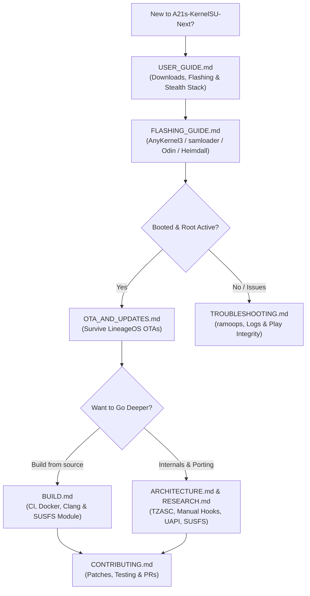

[← Repository Home](../README.md)

# Documentation Hub — Galaxy A21s KernelSU-Next

> Everything you need to flash, root, configure stealth, update, build, debug, and contribute to **A21s-KernelSU-Next** (`SM-A217F` / LineageOS 24) in one place.

---

## Jump to What You Need

| I want to… | Go here |
| :--- | :--- |
| Get root on my A21s for the first time (no PC compiling) | [User Installation Guide](USER_GUIDE.md) |
| Flash the kernel ZIP via Recovery (`AnyKernel3`) | [AnyKernel3 Method](FLASHING_GUIDE.md#method-2-anykernel3-via-recovery-no-pc-required) |
| Flash via Linux terminal (`samloader`) | [samloader Method](FLASHING_GUIDE.md#method-1-samloader-linux--recommended) |
| Compile the kernel or `susfs4ksu-v1.5.5.zip` from source | [Kernel Build Guide](BUILD.md) |
| Keep root across a LineageOS OTA update | [OTA & Updates Survival](OTA_AND_UPDATES.md) |
| Debug a bootloop, pull `pstore` logs, or check Play Integrity | [Troubleshooting & Diagnostics](TROUBLESHOOTING.md) |
| Understand TZASC manual hooks, UAPI 5, and SUSFS v1.5.5 | [Technical Architecture](ARCHITECTURE.md) |
| Read the full crash analysis & device-tree research log | [Technical Research Report](RESEARCH.md) |
| Submit a patch, bug report, or port to another Exynos device | [Contributing Guidelines](CONTRIBUTING.md) |

---

## Documentation Index

| Document | Target Audience | Summary |
| :--- | :--- | :--- |
| **[User Installation Guide](USER_GUIDE.md)** | End users | Prebuilt downloads, ROM compatibility, manager allowlist, ReZygisk/Vector/HMA-OSS/AlwaysStrong stack. |
| **[Flashing Guide](FLASHING_GUIDE.md)** | All users | Detailed flashing walkthroughs for `AnyKernel3`, `samloader`, `Odin`, `Heimdall`, and raw `dd`. |
| **[Kernel Build Guide](BUILD.md)** | Developers / Power users | Cloud CI, Docker, [`build.py`](../build.py), native Clang compilation, and `susfs4ksu-v1.5.5.zip` packaging. |
| **[OTA & Updates Survival](OTA_AND_UPDATES.md)** | Daily drivers | Restoring root after LineageOS OTAs in seconds without losing data or modules. |
| **[Technical Architecture](ARCHITECTURE.md)** | Kernel engineers | Deep dive into Exynos 850 TrustZone (`irq/160-tzasc`), manual hooks, Dynamic UAPI, and SUSFS `fs_context`. |
| **[Technical Research Report](RESEARCH.md)** | Researchers / Porters | Hardware trap root cause, partition geometry (`36 MiB`), overlay workspace design, and engineering outcomes. |
| **[Troubleshooting & Diagnostics](TROUBLESHOOTING.md)** | All users | Automated [`build.py report-issue`](../build.py) reporter, `ramoops`/`dmesg`/`ksud` logs, Safe Mode, and Play Integrity. |
| **[Contributing Guidelines](CONTRIBUTING.md)** | Contributors | Commit format, patch workflow, hardware testing checklist, and Exynos porting steps. |

---

## Reading Flow — Where to Start

> [!TIP]
> **End users:** Follow the top-to-bottom path starting with [User Installation Guide](USER_GUIDE.md).
> **Kernel developers:** Jump straight to [Technical Architecture](ARCHITECTURE.md) and [Kernel Build Guide](BUILD.md).

---

## Upstream & Companion Repositories

| Component | Repository & Branch / Release | Role |
| :--- | :--- | :--- |
| **Exynos 850 Kernel Tree** | [`samsungexynos850/android_kernel_samsung_exynos850`](https://github.com/samsungexynos850/android_kernel_samsung_exynos850/tree/lineage-24.0) (`lineage-24.0`) | Linux `4.19.325` (`b8c71b7aecec`) upstream base kernel |
| **LineageOS Device Tree** | [`LineageOS/android_device_samsung_a21s`](https://github.com/LineageOS/android_device_samsung_a21s) | Partition layout (`boot` 36 MiB, header v2, page size 2048) |
| **AOSP Clang Toolchain** | [`LineageOS/android_prebuilts_clang_kernel_linux-x86_clang-r416183b`](https://github.com/LineageOS/android_prebuilts_clang_kernel_linux-x86_clang-r416183b) | Clang 12.0.5 (`clang-r416183b`) + LLVM tools |
| **KernelSU-Next** | [`KernelSU-Next/KernelSU-Next`](https://github.com/KernelSU-Next/KernelSU-Next/tree/legacy) (`legacy`) · [Manager v3.4.2](https://github.com/KernelSU-Next/KernelSU-Next/releases/tag/v3.4.2) | Non-GKI kernel root driver & manager UI (`UAPI 5`) |
| **SUSFS** | [`simonpunk/susfs4ksu`](https://gitlab.com/simonpunk/susfs4ksu/-/tree/kernel-4.19) (`kernel-4.19`) | Kernel VFS stealth (`v1.5.5`) + userspace `ksu_susfs_arm64` |
| **Stealth Module Stack** | [ReZygisk](https://github.com/PerformanC/ReZygisk) · [Vector](https://github.com/JingMatrix/Vector) · [HMA-OSS](https://github.com/frknkrc44/HMA-OSS) · [zygisk-detach](https://github.com/j-hc/zygisk-detach) · [AlwaysStrong](https://gitlab.com/Evokerr/AlwaysStrong/-/releases) | Zygisk, Xposed hooking, app concealment, and Play Integrity |

---

## Before You Begin

> [!IMPORTANT]
> Verify every prerequisite below before flashing or building:

- **Device:** Samsung Galaxy A21s (`SM-A217F` / `SM-A217M` / `SM-A217N`, codename `a21s`, SoC `universal850`).
- **ROM:** **LineageOS 24 (Android 17 / SDK 37)** or compatible AOSP ROM *(Stock OneUI is **not** supported)*.
- **Unlocked bootloader** and **stock `boot.img` backup** stored safely off-device.
- **Custom recovery** (Lineage Recovery, [TWRP](https://twrp.me), or [OrangeFox](https://orangefox.download)) for `AnyKernel3` flashes, or **USB Debugging** for PC flashing.

> [!CAUTION]
> Always confirm your ROM base and device model (`SM-A217F` / `M` / `N`) before flashing raw images to `/dev/block/by-name/boot`.

---

## Suggested Reading Order

| If you just finished… | Read next… |
| :--- | :--- |
| This hub | [User Installation Guide](USER_GUIDE.md) |
| User Installation Guide | [Flashing Guide](FLASHING_GUIDE.md) |
| Flashing Guide | [OTA & Updates Survival](OTA_AND_UPDATES.md) |
| OTA & Updates Survival | [Troubleshooting & Diagnostics](TROUBLESHOOTING.md) |
| Troubleshooting | [Technical Architecture](ARCHITECTURE.md) |
| Technical Architecture | [Technical Research Report](RESEARCH.md) |
| Technical Research Report | [Kernel Build Guide](BUILD.md) |
| Kernel Build Guide | [Contributing Guidelines](CONTRIBUTING.md) |
