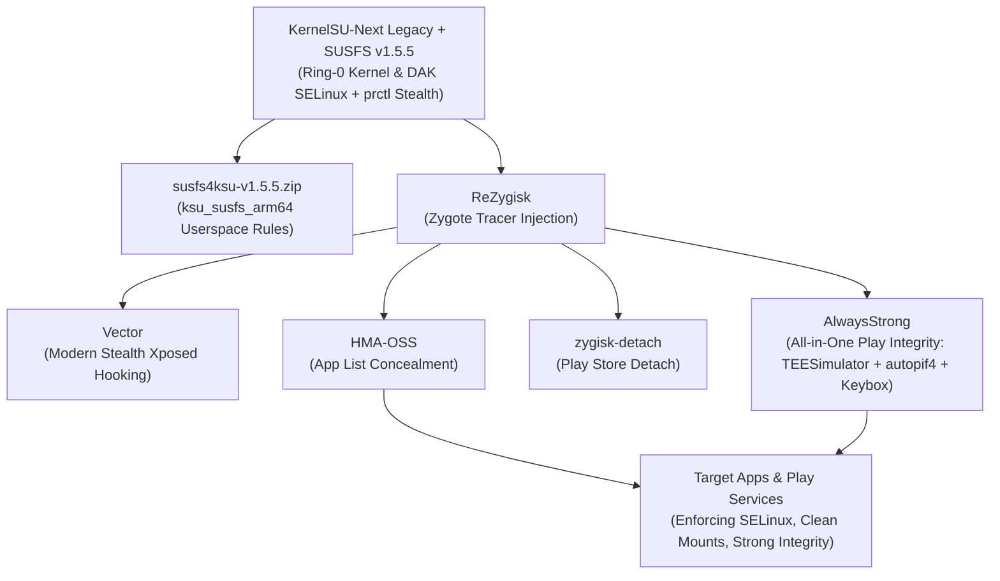

[← Documentation Hub](README.md) · [Main README](../README.md)

# User Guide — KernelSU-Next on Galaxy A21s

> **TL;DR:** Flash a prebuilt KernelSU-Next + SUSFS kernel onto your **Samsung Galaxy A21s (`SM-A217F`)** running **LineageOS 24**, install the manager app, and configure per-app root + stealth — no compilation needed.

---

## Jump to What You Need

| I want to… | Go to… |
| :--- | :--- |
| Check device & ROM prerequisites | [Before You Begin](#before-you-begin) |
| Download the prebuilt release files | [Downloads](#downloads) |
| Check if my ROM works (`LineageOS 24` vs other ROMs vs `OneUI`) | [ROM & Boot Image Compatibility Matrix](#rom--boot-image-compatibility-matrix) |
| Flash via Recovery (easiest, no PC) | [Method 1: Recovery Flash](#method-1-recovery-flash-recommended--no-pc-needed) |
| Flash via `samloader` (Linux / macOS) | [Method 2: Flash via `samloader`](#method-2-flash-via-samloader-linux--macos) |
| Flash via Odin (Windows) | [Method 3: Flash via Odin](#method-3-flash-via-odin-windows) |
| Verify root & grant access to apps | [Setting Up the Manager & Granting Root](#setting-up-the-manager--granting-root) |
| Set up `SUSFS`, `ReZygisk`, `Vector`, `HMA-OSS`, and `AlwaysStrong` | [Advanced Module Setup & Stealth Isolation Stack](#advanced-module-setup--stealth-isolation-stack) |

---

## Before You Begin

Ensure all of the following are ready before flashing:

- **Device:** Samsung Galaxy A21s (`SM-A217F`, `SM-A217M`, or `SM-A217N`) with an **unlocked bootloader**.
- **ROM:** [LineageOS 24](https://github.com/LineageOS/android_device_samsung_a21s) (Android 17 / SDK 37) installed and booting normally.
  > [!WARNING]
  > Stock Samsung OneUI (OneUI 2, 3, or 4) is **not supported**. The kernel ABI and proprietary Samsung security modules are incompatible — do not flash on stock OneUI.
- **Recovery** *(for Method 1)*: Lineage Recovery, [TWRP](https://twrp.me), or [OrangeFox](https://orangefox.download).
- **USB Debugging & ADB** *(for PC methods / log capture)*: Enable via *Settings → About Phone → tap Build Number 7× → Developer Options → USB Debugging*, with [Android SDK Platform-Tools](https://developer.android.com/tools/releases/platform-tools) installed.
- **Backup:** Copy your stock `boot.img` off-device before making changes.

---

## Downloads

Download the latest release assets from [GitHub Releases (`latest`)](https://github.com/rebeeh/A21s-KernelSU-Next/releases/latest):

| File | Purpose | Flash / Install With |
| :--- | :--- | :--- |
| [`KernelSU-Next-A21s-universal850-AnyKernel3.zip`](https://github.com/rebeeh/A21s-KernelSU-Next/releases/latest/download/KernelSU-Next-A21s-universal850-AnyKernel3.zip) | Flashable recovery ZIP — preserves your existing ROM ramdisk *(Recommended)* | Lineage Recovery / [TWRP](https://twrp.me) / [OrangeFox](https://orangefox.download) |
| [`boot-ksu.tar`](https://github.com/rebeeh/A21s-KernelSU-Next/releases/latest/download/boot-ksu.tar) | Odin AP archive (`boot.img` wrapped for Windows flashing) | [Samsung Odin](https://odindownload.com) |
| [`boot-ksu.img`](https://github.com/rebeeh/A21s-KernelSU-Next/releases/latest/download/boot-ksu.img) | Raw patched boot partition image (`36 MiB` LineageOS 24 ramdisk) | [`samloader`](https://github.com/topjohnwu/samloader-rs) / [`heimdall`](https://github.com/Benjamin-Dobell/Heimdall) / `dd` |
| [`susfs4ksu-v1.5.5.zip`](https://github.com/rebeeh/A21s-KernelSU-Next/releases/latest/download/susfs4ksu-v1.5.5.zip) | Version-matched [SUSFS v1.5.5](BUILD.md#building-the-susfs-v155-companion-module-susfs4ksu-v155zip) userspace module (`ksu_susfs_arm64`) | KernelSU-Next Manager → **Modules** |
| [`KernelSU_Next_v3.4.2.apk`](https://github.com/KernelSU-Next/KernelSU-Next/releases/download/v3.4.2/KernelSU_Next_v3.4.2.apk) | Official [KernelSU-Next Manager](https://github.com/KernelSU-Next/KernelSU-Next/releases/tag/v3.4.2) app (`UAPI 5` aligned) | Android Installer / `adb install` |

> [!TIP]
> **Minimal first-time download:** On LineageOS 24 with recovery access, grab [`KernelSU-Next-A21s-universal850-AnyKernel3.zip`](https://github.com/rebeeh/A21s-KernelSU-Next/releases/latest/download/KernelSU-Next-A21s-universal850-AnyKernel3.zip), [`KernelSU_Next_v3.4.2.apk`](https://github.com/KernelSU-Next/KernelSU-Next/releases/download/v3.4.2/KernelSU_Next_v3.4.2.apk), and (for hiding/Play Integrity) [`susfs4ksu-v1.5.5.zip`](https://github.com/rebeeh/A21s-KernelSU-Next/releases/latest/download/susfs4ksu-v1.5.5.zip).

---

## ROM & Boot Image Compatibility Matrix

| ROM | AnyKernel3 Zip | `boot-ksu.img` / `boot-ksu.tar` | Notes |
| :--- | :---: | :---: | :--- |
| **LineageOS 24 (Android 17)** | Supported | Supported | Native target ROM. Prebuilt `boot-ksu.img` includes the LineageOS 24 ramdisk. |
| **Other AOSP ROMs** (crDroid, PixelOS, LineageOS 20/21) | Supported | Requires Repack | Always use **AnyKernel3 Zip** in recovery so your ROM's own ramdisk is preserved. Do **not** flash `boot-ksu.img` directly. |
| **Stock Samsung OneUI** (OneUI 2, 3, 4) | Incompatible | Incompatible | Incompatible kernel ABI, Knox/DEFEX, and Samsung proprietary drivers. |

> [!IMPORTANT]
> If you are on **any ROM other than LineageOS 24**, always use **Method 1 (AnyKernel3 Zip)**. Flashing a mismatched `boot-ksu.img` will fail to boot.

---

## Installation Methods

### Method 1: Recovery Flash (Recommended — No PC needed!)

1. Copy [`KernelSU-Next-A21s-universal850-AnyKernel3.zip`](https://github.com/rebeeh/A21s-KernelSU-Next/releases/latest/download/KernelSU-Next-A21s-universal850-AnyKernel3.zip) onto internal storage or a microSD card.
2. Reboot to Recovery:
   - **Keys:** Power off → hold **Volume Up + Power** until recovery loads.
   - **ADB:** `adb reboot recovery`
3. Install the zip:
   - **[TWRP](https://twrp.me) / [OrangeFox](https://orangefox.download):** Tap **Install** → select the zip → swipe to flash.
   - **LineageOS Recovery:** Tap **Apply update** → **Choose from internal storage** (or **Apply from ADB** + `adb sideload KernelSU-Next-A21s-universal850-AnyKernel3.zip`).
     > [!NOTE]
     > If Lineage Recovery shows *"Signature verification failed. Install anyway?"*, tap **Yes** — expected for custom kernels.
4. Tap **Reboot system now**.

---

### Method 2: Flash via `samloader` (Linux / macOS)

Uses [`samloader`](https://github.com/topjohnwu/samloader-rs) (see [Flashing Guide](FLASHING_GUIDE.md) for [`heimdall`](https://github.com/Benjamin-Dobell/Heimdall) and raw `dd` steps):

1. Enter Download Mode (`adb reboot download`, or power off → hold **Volume Up + Volume Down** while plugging USB cable).
2. Flash [`boot-ksu.img`](https://github.com/rebeeh/A21s-KernelSU-Next/releases/latest/download/boot-ksu.img):
   ```bash
   samloader flash --partition BOOT boot-ksu.img
   ```
3. The phone reboots automatically.

---

### Method 3: Flash via Odin (Windows)

1. Enter Download Mode (power off → hold **Volume Up + Volume Down** while plugging USB cable, or run `adb reboot download`).
2. Launch [Odin3 v3.14+](https://odindownload.com) on Windows and confirm a blue `ID:COM` port box appears.
3. Click **AP** and select [`boot-ksu.tar`](https://github.com/rebeeh/A21s-KernelSU-Next/releases/latest/download/boot-ksu.tar).
4. Click **Start** and wait for the green **`PASS!`** indicator before unplugging.

> [!CAUTION]
> Leave **Re-Partition** unchecked in Odin — checking it can corrupt your partition table.

---

## Setting Up the Manager & Granting Root

1. Install [`KernelSU_Next_v3.4.2.apk`](https://github.com/KernelSU-Next/KernelSU-Next/releases/download/v3.4.2/KernelSU_Next_v3.4.2.apk) (`adb install KernelSU_Next_v3.4.2.apk` or tap the APK on-device).
2. Open **KernelSU Next** and confirm the dashboard reports:
   - **Status:** `Working [BUILT-IN (GKI1)]`
   - **Hook mode:** `Manual`
   - **Manager / Driver:** `v3.4.2 (33355-5)`
   - **SuSFS version:** `Supported | v1.5.5 (NON-GKI)` *(once [`susfs4ksu-v1.5.5.zip`](https://github.com/rebeeh/A21s-KernelSU-Next/releases/latest/download/susfs4ksu-v1.5.5.zip) is flashed under **Modules**)*
3. Use the **Superuser (Shield)** tab to grant root only to apps you explicitly trust.

> [!TIP]
> If the app does not show `Working`, verify you flashed onto a supported LineageOS/AOSP ROM and check [Troubleshooting — Issue 1](TROUBLESHOOTING.md#issue-1-manager-shows-unsupported--not-integrated).

---

## Why Root Checker Shows "Not Properly Installed" at First

If an unprivileged app checks for `/system/bin/su`, the KernelSU-Next kernel driver returns `-ENOENT` (`File Not Found`) by default.

| Security Property | Magisk (Global `su`) | KernelSU-Next (Kernel Allowlist) |
| :--- | :--- | :--- |
| **How `su` is exposed** | Mounted globally; requires denylist exclusions | Hidden in kernel space for every non-granted UID |
| **Unapproved apps see** | Root markers unless hidden per-app | `-ENOENT` — appears 100% unrooted |
| **Model** | Opt-out (blocklist) | Strict opt-in (allowlist) |

To grant root to an app: open **KernelSU Next** → **Superuser (Shield)** → tap the app → toggle **Superuser** **ON**.

> [!NOTE]
> For `adb shell su`, grant **Shell** (`com.android.shell`, UID 2000) under **Show system apps** or toggle **ADB Root** in Manager settings — see [Troubleshooting — Blindspot 1](TROUBLESHOOTING.md#blindspot-1-adb-shell-su-fails).

---

## Advanced Module Setup & Stealth Isolation Stack

For banking apps, Xposed modules, and passing Play Integrity (`BASIC` / `DEVICE` / `STRONG_INTEGRITY`), install the validated module stack via **KernelSU Next → Modules**:



### Validated Modules

1. **[SUSFS Companion (`susfs4ksu-v1.5.5.zip`)](https://github.com/rebeeh/A21s-KernelSU-Next/releases/latest/download/susfs4ksu-v1.5.5.zip):** Installs `ksu_susfs_arm64` to configure boot-time mount/path hiding matching the `v1.5.5` kernel hooks. *(See [Build Guide](BUILD.md#building-the-susfs-v155-companion-module-susfs4ksu-v155zip) to build from source.)*
2. **[ReZygisk](https://github.com/PerformanC/ReZygisk):** Standalone Zygisk API via ptrace tracer injection.
   - Verify: `adb shell cat /data/adb/modules/rezygisk/module.prop` reports `[Monitor: ✅, ReZygisk 64-bit: ✅, ReZygisk 32-bit: ✅]`.
   - *Note:* An informational `ZYGISK REQUIRED` badge inside KernelSU-Next Manager is harmless — see [Troubleshooting — Issue 6](TROUBLESHOOTING.md#issue-6-manager-shows-zygisk-required-badge-on-active-modules).
3. **[Vector](https://github.com/JingMatrix/Vector):** Modern stealth Xposed framework replacing legacy LSPosed.
4. **[HMA-OSS](https://github.com/frknkrc44/HMA-OSS):** Conceals root manager, Vector, and Xposed apps from targeted packages via a hide template.
5. **[zygisk-detach](https://github.com/j-hc/zygisk-detach):** Unbinds selected apps from Play Store auto-updates.
6. **[AlwaysStrong](https://gitlab.com/Evokerr/AlwaysStrong/-/releases) (All-in-One Play Integrity):** Bundles `TEESimulator`, `autopif4`, keybox fetching, and a WebUI dashboard.

> [!IMPORTANT]
> **Do not install duplicate Play Integrity modules** (`PlayIntegrityFix` / `PlayIntegrityFork`, standalone `Tricky Store`, or `Yurikey`) alongside **AlwaysStrong** — duplicate modules hook the same binder/keystore paths and conflict. Our kernel already embeds the Samsung `hal_keymaster_default` DAK SELinux rules (`ret -932` fix), so `MEETS_BASIC`, `MEETS_DEVICE`, and `MEETS_STRONG_INTEGRITY` pass cleanly once AlwaysStrong fetches an active keybox (or after loading your private OEM `keybox.xml`).

<details>
<summary><strong>Auditing stealth with Duck Detector (expected clean vs setup signals)</strong></summary>

- **Expected Clean on this kernel (`v1.2.0+`):**
  - `No suspicious kernel markers`
  - `Function hooks: Clean`, `Mappings: Clean`, `Loader visibility: Clean`
  - `Native Root` clean (`prctl(0xDEADBEEF)` is guarded to `GLOBAL_ROOT_UID`; keep `/data/local/tmp/` free of leftover `ksud`/temp binaries)
  - `TEE: Attestation aligned` (built-in `hal_keymaster_default` DAK SELinux rules active on boot)
- **Expected Setup Signals (user-configurable):**
  - `Dangerous Apps` / `Root Managers` → Clears when you import your `HMA-OSS` hide config and add the detector app to your template.
  - `ADB Runtime` → Clears when **USB Debugging** is disabled after setup.
  - See [Troubleshooting — Blindspot 4](TROUBLESHOOTING.md#blindspot-4-google-play-integrity-knox-tripping--hardware-attestation) for additional details on LineageOS `userdebug` properties and Vector `xposed_data` SELinux context behavior.

</details>

---

## Related Docs

| Document | Description |
| :--- | :--- |
| [Flashing Guide](FLASHING_GUIDE.md) | Step-by-step commands for AnyKernel3, `samloader`, Odin, Heimdall, and `dd` |
| [OTA Updates Survival](OTA_AND_UPDATES.md) | Re-apply KernelSU-Next after LineageOS nightlies in 5 seconds |
| [Kernel Build Guide](BUILD.md) | Build the kernel and `susfs4ksu-v1.5.5.zip` locally or via GitHub Actions |
| [Troubleshooting & Diagnostics](TROUBLESHOOTING.md) | Crash logs, Safe Mode bootloop recovery, and Play Integrity fixes |
| [Technical Architecture](ARCHITECTURE.md) | Exynos 850 TZASC, Manual Hooks, Dynamic UAPI, and SUSFS design |
| [Documentation Hub](README.md) | Full docs map and upstream references |
